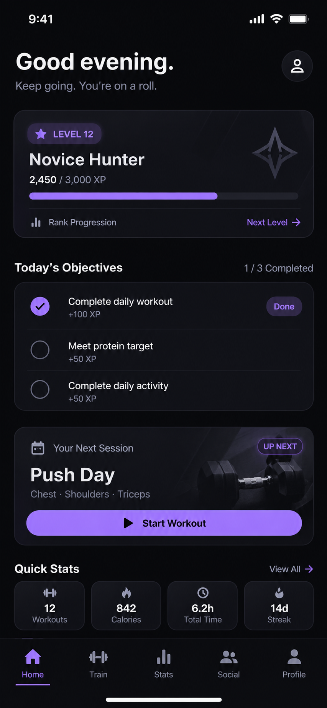

<p align="center">
  
</p>

<h1 align="center">STRYDE</h1>

<p align="center">
  <strong>Level Up Your Fitness.</strong><br>
  A distraction-free workout tracker with subtle RPG progression mechanics. Built for lifters who want to focus.
</p>

<p align="center">
  <a href="https://github.com/RemanentBadge11/Stryde/releases"></a>
  <a href="https://flutter.dev"></a>
  <a href="https://dart.dev"></a>
  <a href="https://supabase.com"></a>
  
  
</p>

<p align="center">
  <a href="https://github.com/RemanentBadge11/Stryde/releases">
    
  </a>
</p>

---

<p align="center">
  
</p>

---

## ⚡ What is Stryde?

Most fitness apps are either cluttered with social feeds, paywalled behind subscriptions, or feel like cold spreadsheets.

**Stryde** takes a different approach:
- **Distraction-Free Logging**: Clean, high-contrast dark theme designed to be tapped with sweaty gym hands in seconds.
- **Subtle RPG Progression**: Every set, workout, and habit awards XP. Level up your rank from *Fresher* to elite tiers, earn attribute points, and allocate them across your muscle groups.
- **Zero Gimmicks**: No subscriptions. No ads. No spam notifications. Completely free.

---

## ✨ Features

### 🏋️ Serious Workout Tracking
- **Active Workout Logger**: Record sets, reps, weight (kg/lbs), and RPE on the fly.
- **Personal Record (PR) Celebrations**: Animated celebration overlays and custom audio cues trigger whenever you hit a new PR.
- **Routines & Templates**: Build custom split routines (PPL, Upper/Lower, Full Body) or start empty free-training sessions.
- **Rest Timer & Audio Feedback**: Integrated sound cues for completed sets and intervals.

### 🎮 RPG Character Progression
- **Rank Tiers**: Level up your lifter rank:
  - 🔰 **Fresher** (Levels 1–5): *Every legend starts at zero.*
  - ⚡ **Rising Star** (Levels 6–10): *The work starts to become a habit.*
  - 🔥 **Locked In** (Levels 11–15): *Forged by consistency and intent.*
  - 👑 *Higher tiers unlock as you advance.*
- **Skill Allocation Tree**: Distribute earned skill points directly into your muscle groups: **Chest**, **Back**, **Legs**, **Shoulders**, **Arms**, and **Core**.
- **Login & Workout Streaks**: Real-time streak tracking to keep you disciplined.

### 📜 Quests, Habits & Daily Goals
- **Daily Targets**: Track daily steps, hydration (water intake in liters), and protein targets with live progress rings.
- **Weekly Quest Pool**: Dynamic weekly challenges that reward bonus XP upon completion.
- **Daily Habits**: Gamified daily checkboxes to maintain recovery habits outside the gym.

### 🏅 Medals & Achievements
- Automated medal unlocks celebrating volume milestones, workout counts, and consistency achievements.
- Showcase your earned medals directly on your profile.

### 📚 Exercise Library
- Built-in library of **100+ exercises** with visual demonstrations.
- Filter by targeted muscle group (Chest, Back, Shoulders, Biceps, Triceps, Quads, Hamstrings, Glutes, Calves, Core).
- Exercise search and detailed movement guides.

### 🎨 Themes & Customization
- Ultra-clean minimalist dark mode with customizable accent colors.
- Platform-adaptive navigation bar (optimized for both Android and iOS gesture navigation).
- Profile avatars and customized user handles synced to the cloud.

---

## 🛠️ Tech Stack & Architecture

Stryde is built with clean architecture and reactive state management:

| Layer | Technologies |
| :--- | :--- |
| **Framework** | [Flutter](https://flutter.dev) (Dart `>=3.12.0 <4.0.0`) |
| **State Management** | [Flutter Riverpod](https://riverpod.dev) (`^3.5.0`) |
| **Navigation & Routing** | [GoRouter](https://pub.dev/packages/go_router) (`^18.1.4`) with deep-link & auth guards |
| **Backend & Database** | [Supabase](https://supabase.com) (PostgreSQL, Auth, Row Level Security, Storage) |
| **Audio** | [AudioPlayers](https://pub.dev/packages/audioplayers) for workout cues |
| **Icons & Design** | Material UI, Cupertino Icons, and custom typography |

### Directory Structure

```text
lib/
├── core/                       # Shared foundational layer
│   ├── providers/              # Global state notifiers
│   ├── routing/                # GoRouter setup & platform navigation shells
│   ├── services/               # Audio & native services
│   ├── supabase/               # Supabase client wrapper
│   ├── theme/                  # Colors, spacing, typography, dynamic themes
│   └── widgets/                # Common cards, headers, loaders, platform bars
├── features/                   # Feature-based modular structure
│   ├── auth/                   # Email/password authentication & session guards
│   ├── exercises/              # Exercise catalog, JSON loaders, search, media
│   ├── home/                   # Dashboard: daily goals, habits, weekly quests
│   ├── medals/                 # Achievement unlocking and medal showcase
│   ├── profile/                # User profile, goal metrics, avatar management
│   ├── progression/            # XP transactions, ranks, skill allocations
│   ├── routines/               # Custom routine builder and routine details
│   ├── settings/               # Accent color picker, theme mode, app preferences
│   ├── stats/                  # Workout history analytics and trends
│   ├── workout_history/        # Completed workouts and detailed breakdown
│   └── workout_logging/        # Active session tracker, set inputs, PR overlay
└── main.dart                   # Application bootstrap & dependency setup
```

---

## 🚀 Getting Started

### Prerequisites

Ensure you have the following installed:
- [Flutter SDK](https://docs.flutter.dev/get-started/install) (`>= 3.12.0`)
- [Android Studio](https://developer.android.com/studio) or [VS Code](https://code.visualstudio.com/) with Flutter extensions
- Android device or emulator running API 21+

### Installation & Run

1. **Clone the repository**:
   ```bash
   git clone https://github.com/RemanentBadge11/Stryde.git
   cd Stryde
   ```

2. **Install dependencies**:
   ```bash
   flutter pub get
   ```

3. **Configure Environment Variables** (Optional):
   Create a `.env` file in the root directory (or use default development fallback):
   ```env
   SUPABASE_URL=https://your-project.supabase.co
   SUPABASE_ANON_KEY=your-supabase-publishable-key
   ```

4. **Launch the app**:
   ```bash
   flutter run
   ```

### Running Tests

```bash
flutter test
```

---

## 📦 Building for Release

### Android APK:
```bash
flutter build apk --release
```
The compiled APK will be output to `build/app/outputs/flutter-apk/app-release.apk`.

### Android App Bundle (AAB for Google Play):
```bash
flutter build appbundle --release
```

---

## 📥 Download

Pre-built APKs for Android are available on the [GitHub Releases](https://github.com/RemanentBadge11/Stryde/releases) page.

1. Download `Stryde-x.x.x.apk`.
2. Open the APK on your Android device.
3. Allow installation from unknown sources if prompted.
4. Level up!

---

## 🤝 Contributing

Contributions are welcome! If you'd like to improve Stryde:

1. Fork the Project
2. Create your Feature Branch (`git checkout -b feature/AmazingFeature`)
3. Commit your Changes (`git commit -m 'Add some AmazingFeature'`)
4. Push to the Branch (`git push origin feature/AmazingFeature`)
5. Open a Pull Request

---

## 📄 License

Distributed under the MIT License. See `LICENSE` for more information.

<p align="center">
  <sub>Built with passion for lifters everywhere.</sub>
</p>
